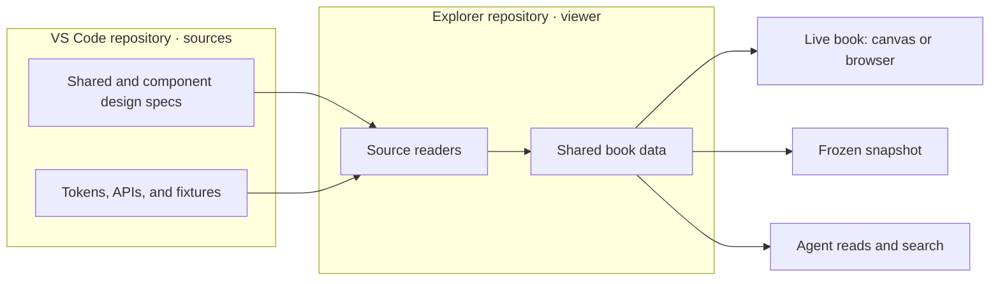

# VS Code Design System Explorer

Explore VS Code's design guidance alongside the tokens, APIs, and examples it describes. This repository provides the **viewer**, available as a Copilot canvas or in a browser. Your **VS Code worktree** provides the design specs, code, and fixtures.

[Browse the published snapshot](https://chryw.github.io/vscode-design-system/) without installing the plugin.

## Quick start

1. **Install the plugin.** On the machine running your Copilot session, use the [Copilot CLI](https://docs.github.com/copilot/how-tos/copilot-cli):

   ```sh
   copilot plugin marketplace add chryw/vscode-design-system
   copilot plugin install vscode-design-system@vscode-design-system
   ```

2. **Open the docs reference.** Start a Copilot session in a [prepared VS Code checkout](docs/setup.md#component-apis-and-live-examples) using **Open Agents Window**. Ask: “Open the Visual Studio Code Design System canvas using the shared branch https://github.com/microsoft/vscode/tree/chryw/design-system-docs-pr.”

3. **Check the content version.** The reference currently follows the docs-only [microsoft/vscode#350445](https://github.com/microsoft/vscode/pull/350445), not experimental product changes. In an existing canvas, use the chevron beside **Refresh**, choose **Shared branch…**, and paste that branch URL. Your session's Git checkout is unchanged.

Guidance and source-derived APIs need no build or installation in the downloaded source checkout. For live examples, [prepare a local docs-only checkout](docs/setup.md#prepare-the-docs-only-checkout). The source documents are draft guidance, not product-wide policy.

### Set up with Copilot

Share this README with Copilot or paste this prompt into a session with canvas support:

> Set up the VS Code Design System Explorer from https://github.com/chryw/vscode-design-system. Follow its quick start and AGENTS.md from a VS Code session with its normal dependencies installed. Open the canvas with the shared content version https://github.com/microsoft/vscode/tree/chryw/design-system-docs-pr without switching my checkout. Reuse an existing panel through its owning chat. Prepare a separate docs-only checkout only for local authoring or live examples.

## How it works



VS Code keeps shared guidance for foundations and patterns together, and component specs beside their implementation. Specs explain design intent and usage; product code defines the implemented behavior.

## Review and contribute

### Explore and apply guidance

Before building or reviewing UI, browse the relevant foundation, component, or pattern. For example, use **Spacing** to decide how to group related controls, then follow **Contributor resources** to the files behind the chapter.

### Change guidance or product UI in `microsoft/vscode`

Edit the owning spec, code, or fixture in your VS Code worktree. Choose **This session** to review saved local changes, then use **Refresh**. If a UI change affects existing guidance, review both in the same PR; new specifications are not required for every control. For agent-assisted work, use the [design-system skill in the docs contribution](https://github.com/microsoft/vscode/blob/chryw/design-system-docs-pr/.github/skills/design-system/SKILL.md).

### Change the explorer in this repository

Edit this repo when changing how the explorer reads, renders, or navigates the book. Use the [development commands](docs/setup.md#development) to preview and test viewer changes against a VS Code checkout.

[Setup and troubleshooting](docs/setup.md) · [Local browser viewer](docs/setup.md#local-browser) · [Architecture](docs/architecture.md) · [Agent guide](AGENTS.md)
